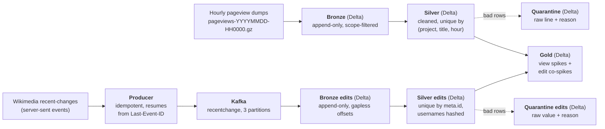

# Vantage

[](https://github.com/kumkumsareen1006/Vantage/actions/workflows/tests.yml)

A Spark + Delta Lake pipeline over English Wikipedia pageviews and edits. Together,
Phase 1 and Phase 2 now answer the full question this project was built toward:
which articles suddenly drew unusual attention in a given hour — a spike of views
larger than their own recent history explains — which of those spikes look automated
rather than driven by real readers, and whether people were editing those same
articles at the same time. Phase 1 reads the raw hourly pageview dumps, cleans and
aggregates them through medallion layers, and scores each (title, hour) against a
24-hour baseline. The automated-traffic flag is a heuristic: a desktop-only,
single-hour burst is a strong signal of scraper or redirect traffic, not a verified
label.

Phase 1 is a local batch lakehouse over the pageview dumps. **Phase 2 adds the live
edit stream** — the Wikimedia recent-changes feed through Kafka and Spark Structured
Streaming into the same medallion layers, then joined to the pageview spikes to show
which surges of attention were matched by a surge of human editing. Phase 3 (cloud) is
[planned](#roadmap).

## Architecture



The top lane is Phase 1 (batch). The bottom lane is Phase 2 (streaming): the live edit
feed is produced to Kafka and streamed through its own Bronze and Silver, then joined
into Gold where a view spike and a human-edit spike in the same hour become a co-spike.

- **Bronze** — every in-scope raw line landed exactly as read, one file per hour,
  appended and never rewritten. Re-landing a file is a no-op, so the ingest is
  idempotent. Every in-scope line of every landed file is there; nothing is
  filtered beyond the en/en.m scope.
- **Silver** — parsed, title-normalized, collision-aggregated, and unique by
  `(project, title, hour)`. Written with a MERGE that replaces a key's row
  instead of adding one, so a rerun can't double-count.
- **Quarantine** — any row that fails to parse or validate is kept here with its
  raw text and a reason, never dropped silently and never allowed to crash the
  run. Reprocessing a file clears its old quarantine rows first.
- **Gold** — `top_pages_hourly`, `top_pages_daily`, `spikes` (the z-score table),
  and `co_spikes` (a view spike and a human-edit spike in the same hour). Each is a
  pure function of Silver, overwritten every build, so it can't accumulate or drift;
  a build is skipped entirely when Silver hasn't changed.

The full set of filters, drops, and thresholds each layer applies is written up
as an exact spec in [docs/cleaning-rules.md](docs/cleaning-rules.md).

## Scope: `en` and `en.m` only

Vantage keeps only the English desktop (`en`) and English mobile (`en.m`)
projects and drops everything else — at ingest, in Bronze, before anything is
stored. That is a **scoping** decision, not a cleaning one: the full hourly dump
is every project and language and would be far larger than this needs to be to
run on a laptop. Narrowing to two projects keeps the data small enough to
iterate on while staying real, uncontrolled public data. The two are kept
separate through Silver (the desktop/mobile split is what the automated-traffic
flag later depends on) and summed per title in Gold.

## Why Delta

The layers lean on three Delta features that plain Parquet doesn't give you:

- **MERGE** makes Silver idempotent. A key that already exists is updated in
  place rather than appended, so reprocessing a file — or rerunning the whole
  window — converges to the same table instead of piling up duplicates.
- **Schema enforcement** means a stage can't quietly write the wrong shape; a
  column type mismatch fails the write instead of corrupting the table. New
  optional columns are added deliberately with `mergeSchema`.
- **Time travel** keeps each write as a version, so an earlier state of a table
  can be read back by version — exercised in `tests/test_spark_smoke.py`, which
  writes, MERGEs, then reads the pre-MERGE version with `versionAsOf`. VACUUM
  `RETAIN 24 HOURS` then caps how far back time travel reaches at the last 24
  hours of versions.

A separate **quarantine table** exists because the alternative — dropping a bad
line, or letting it throw — either loses data silently or stops a 150M-row run
on one malformed row. Quarantine keeps every rejected line with a reason, so the
reject rate is a number you can watch and the bad rows are there to inspect. A
pageview line that is invalid UTF-8, splits into the wrong number of fields, or
carries a non-integer view count goes to quarantine, not to Silver.

## Idempotency

Silver is written with a MERGE keyed on `(date, project, title, hour)`. A matched
key has its `views`, `bytes`, and `source_file` **replaced**; an unmatched key is
inserted. Nothing is appended to an existing key. So running the pipeline twice,
or rerunning it with `--full`, lands the same table — not a doubled one.

The proof is in both the data and the tests:

- A `--full` rebuild of all 72 files produces exactly `142,728,341` Silver rows,
  and a `GROUP BY (project, title, hour) HAVING count > 1` over that table
  returns **0** duplicate keys.
- `tests/test_silver_merge.py` merges the same batch twice and asserts the row
  count stays `1` with no duplicate key, then merges a changed value and asserts
  the row is replaced (10 → 20, not 30).

## Results

Window: **2026-10-15 00:00 – 2026-10-18 00:00 UTC**, three UTC days, 72 hourly
files. Every number below comes from the `run_metrics` Delta table, a direct
query on the Delta tables, or a test/command run — sources are footnoted; none
are from notes or memory.

| Metric | Value | Source |
|---|---|---|
| Pageview files ingested | 72 | [1] |
| Rows ingested (Bronze) | 152,935,529 | [2] |
| Silver rows | 142,728,341 | [3] |
| Collisions merged (same key, different raw spelling) | 8,678 | [4] |
| Rows quarantined | 0 (0.0000%) | [5] |
| Duplicate Silver keys after a full rerun | 0 | [6] |
| Gold rows | 84,348 = 7,200 hourly + 300 daily + 76,848 spikes | [7] |
| Titles scored for spikes / flagged `is_spike` / `likely_automated` | 1,601 / 2,027 / 7 | [8] |
| Silver files before → after OPTIMIZE | 3 → 3 (already compact) | [9] |
| Silver on-disk before → after VACUUM (RETAIN 24h) | 11,757.0 MB → 2,395.8 MB (reclaimed 9,361.2 MB) | [10] |
| Whole lake on disk before → after VACUUM | ~13 GB → 4.3 GB | [11] |
| Full run: Silver `--full` rebuild (72 files) + Gold | 1,964 s total (Silver MERGE 1,521 s, Gold 434 s) | [12] |
| No-op run (nothing to ingest): Gold rebuilt → Gold skipped | 385 s → 20 s | [13] |
| Tests | 58 passed | [14] |
| CI | green on GitHub Actions (ubuntu-24.04, Temurin 17) | [15] |

<sub>

**Sources.** [1] Bronze `COUNT(DISTINCT source_file)`; also `run_metrics` Silver
`files_processed`. [2] Bronze `count()`. [3] Silver `count()`; also `run_metrics`
Silver `rows_out`. [4] `run_metrics` Silver `rows_in − rows_out`
(142,737,019 − 142,728,341) on the full run of 2026-10-23. [5] `run_metrics`
Silver `rows_quarantined`, over the 152,935,529 Bronze rows. [6] Silver
`GROUP BY (project, title, hour) HAVING count > 1` → 0; `tests/test_silver_merge.py`.
[7] `count()` on each Gold table; also `run_metrics` Gold `rows_out` = 84,348.
[8] Queries on `gold/spikes`: distinct `title`, rows with `is_spike`, rows with
`likely_automated`. [9] `run_metrics` stage `optimize` (`scripts/optimize_silver.py`).
[10] `run_metrics` stage `vacuum:silver` (`scripts/vacuum_tables.py`). [11] `du -sh
data/lake` before and after that VACUUM. [12] `run_metrics`, run 2026-10-23
16:17 UTC (Bronze already landed, so 0 new files that run). [13] `run_metrics`,
runs 2026-10-25 13:36 UTC (Gold rebuilt, 369 s) and 13:42 UTC (Gold skipped,
~1 s). [14] `pytest -q`, 58 passed in 59.4 s locally. [15] GitHub Actions
`tests` workflow, 58 passed in 112.6 s. [16] `scripts/build_silver.py` run output
on Day 7 (4,356.8 s per-file, 1,354.5 s per-day), before `run_metrics` existed.

</sub>

## Findings

**The largest spike in the window was automated traffic, and the flag caught it.**
The single biggest spike was `Ying` — **886,853 views in the one hour
2026-10-17 17:00**, against a baseline near zero. It is 90% desktop
(en 798,356 / en.m 88,497), both neighbouring hours have **0** views, and there
were no edits to the article all window. That shape — one isolated hour, almost
all desktop — is what `likely_automated` is built to catch, and `Ying` is
flagged. Compare `Hôtel_de_Ville,_Limoges`, flagged `is_spike` across 19:00–23:00
the same day: it ramps and decays over several hours and skews mobile
(21:00 was en 2,425 / en.m 4,894), so it is **not** labelled automated — it reads
as real attention. The flag is a label on top of `is_spike`, never a drop, and
the spikes table keeps the view split and both neighbour counts so every label is
auditable.

**Grouping the Silver MERGE by day, not by file, cut the full rebuild ~3×.** The
first version ran one MERGE per pageview file, and each per-file run filtered
Bronze on `source_file` — which isn't the partition column (Bronze is partitioned
by `file_date`). The physical plan showed `PartitionFilters: []`, so nothing was
pruned and the full parse → aggregate → MERGE cycle ran once per file, 72 times
over the window. Switching the batch key to the `file_date` partition prunes the
read to a single day, and because every file covers exactly one hour a day's 24
files aggregate to a byte-identical result, so the window runs in 3 per-day cycles
instead of 72. That dropped the full Silver rebuild from **4,357 s to 1,355 s** [16];
the current `--full` rebuild runs in 1,521 s [12]. The first per-day run then
OOM'd the 4 GB driver — a day's batch is ~24× a single file — until the
aggregation was pinned back to the file-sized task shape (32 MB input partitions,
200 shuffle partitions, AQE coalescing off) so the group-by's hash map stays
inside the heap.

**A parity test caught a UTF-8 quarantine bug.**
`tests/test_parity.py` runs the Phase 0 pandas prototype and the Spark pipeline on
the same fixture — which includes a line with genuinely invalid UTF-8 bytes — and
asserts they produce the identical clean-row set, the same collision count, and
the same quarantine counts *by reason*. The Spark rule flagged `bad_utf8` by
testing whether a line contained the replacement character U+FFFD, assuming
`spark.read.text` substitutes it for invalid bytes. It doesn't: Spark keeps the
raw bytes, so the rule never matched genuinely invalid UTF-8 (the fixture's bad
line slipped past it) and instead wrongly flagged valid lines that happened to
carry a literal U+FFFD. The parity test failed on the per-reason quarantine
counts. The fix flags a line only when it fails a UTF-8 round trip
(`raw_line != decode(encode(raw_line))`). Rebuilding Silver brought the **4** real
`en` article lines whose titles contained a literal U+FFFD back as clean rows, and
the invalid-bytes line now quarantines as `bad_utf8` on both the prototype and
Spark.

## Honest limits

- **It's a 72-hour window.** Three UTC days is enough to prove the pipeline and
  surface real spikes, not enough to characterize weekly or seasonal patterns.
  The spike baseline is 24 hours, so only the last ~48 hours are even scorable.
- **Zero rows were actually quarantined.** The real dump in this window was clean,
  so the 0.0000% reject rate reflects the input, not an untested path. The
  quarantine rules are exercised instead by `tests/test_parity.py` and the unit
  tests against a hand-built fixture with deliberately malformed lines — that is
  where `bad_utf8`, `wrong_field_count`, `bad_url_encoding` and the rest are
  proven, not on production data.
- **`likely_automated` is a heuristic, not ground truth.** "Desktop-dominated and
  isolated" is a strong signal for scraper/redirect bursts, but it is a rule of
  thumb with two tuned thresholds (`DESKTOP_SHARE_MIN = 0.8`,
  `ISOLATION_RATIO = 0.05`), not a verified classification. It's a label to
  filter or inspect by, deliberately kept separate from `is_spike`.

## Phase 2 — streaming the edit feed

Phase 2 brings in the second feed: Wikimedia's live recent-changes stream. Every edit
to English Wikipedia is produced to Kafka, streamed through its own Bronze and Silver
Delta tables, and joined into Gold so a spike of **views** and a spike of human **edits**
in the same hour can be read off together. The hard requirement is that it survives a
crash — the streaming pipeline must not lose or double-count an edit when a process dies
— which the [restart test](docs/restart-test.md) proves on purpose.

### The producer

`vantage/ingest/producer.py` reads the recent-changes server-sent-event stream (English
Wikipedia only) and publishes each event's raw JSON, keyed by title, to the Kafka
`recentchange` topic. Two settings make it safe to crash and restart:

- **Kafka idempotence on** (`enable.idempotence=true`, `acks=all`), so a producer
  retry can't write the same event to the topic twice.
- **Resume from `Last-Event-ID`.** On reconnect the producer sends the last event id it
  durably recorded, so the feed resumes instead of starting over. The resume id is saved
  **only after `flush()` confirms** the events ahead of it reached Kafka, so a crash
  re-reads a few events (at-least-once from the source) rather than skipping any. Every
  confirmed delivery is logged to `data/stream/published.jsonl` as
  `{meta_id, partition, offset}` — the ground truth the restart test checks against.

A 30-minute validation run published **9,970 events = 9,970 confirmed deliveries =
9,970 messages in the topic** (0 failed), surviving 3 reconnects with 0 loss and 0
duplicates.<sup>[a]</sup>

### Bronze and Silver streams, and what each guarantees

- **Bronze edits** is Spark Structured Streaming from Kafka into an append-only Delta
  table, raw message value plus Kafka metadata (topic, partition, offset, timestamp). Its
  guarantee is *no gaps*: every Kafka `(partition, offset)` lands exactly once, contiguous
  from 0. That comes from the streaming **checkpoint**, which records the offsets each
  micro-batch committed, so a restart resumes at the exact offset it stopped at — no
  re-read, no skip. `failOnDataLoss` is left **on**: if offsets Bronze still needs have
  aged out of Kafka, the stream fails loudly rather than silently skipping a gap.
- **Silver edits** parses each Bronze value against an explicit schema and its guarantee
  is *unique by `meta.id`*. It keeps **all** event types and namespaces (the
  `edit`/`new` + namespace-0 filter is applied later, in the Gold join), so the restart
  test can compare Silver's id set against every id the producer logged. Malformed events
  go to a quarantine table with a reason, never dropped silently.

### Two dedup layers, and why the watermark uses `kafka_timestamp`

Upstream duplicates are real: after a reconnect the producer replays recent events, so
the *same* `meta.id` arrives again at a *new* Kafka offset. Silver removes them in two
layers:

1. **`dropDuplicatesWithinWatermark` on `meta.id`**, with a **2-hour** watermark on
   **`kafka_timestamp` (when we ingested the event), not `meta.dt` (when the edit
   happened)**. This matters: after an outage the replayed events carry an *old*
   `meta.dt`, so a `meta.dt` watermark would judge the replay "late" and silently drop
   it — data loss. `kafka_timestamp` is current for a replay, so the duplicate stays
   inside the watermark and is deduped, never dropped. The 2-hour delay bounds the
   in-stream state and covers a producer reconnect-and-replay window; a duplicate that
   arrives more than 2 hours after the original falls outside the watermark and is
   caught instead by layer 2's MERGE.
2. **An insert-only MERGE** (`foreachBatch`) that inserts a `meta.id` only when it isn't
   already present. This is the actual uniqueness guarantee — it holds across all Silver
   history, not just the watermark window — and makes a retried micro-batch a no-op.

### Username hashing

Silver never stores a plaintext username. The `user` field is replaced by
`user_hash = SHA-256(salt + username)`; the salt lives **outside the repo**
(`$VANTAGE_USER_SALT` or `~/.config/vantage/user_salt`) and is never logged. Silver
**refuses to run** if the salt is missing, so it can't quietly fall back to unsalted or
empty-salt hashes. The raw `user`, `comment`, `parsedcomment` and `log_*` fields are
never carried past the parse.

### The restart test

[docs/restart-test.md](docs/restart-test.md) crashes the stream and the producer on
purpose and checks three invariants against the producer's delivery log. On the
2026-11-05 run the stream was **`kill -9`'d mid-batch** (04:09:13 UTC, on Bronze
batch 36 / Silver batch 11) to test checkpoint recovery, and later the producer was
**`kill -9`'d and restarted** (04:19:28 UTC) to force an upstream replay. The results:
Bronze held **53,488** rows, every `(partition, offset)` once and contiguous from 0 on
all three partitions; Silver held **53,480** rows, exactly the 53,480 distinct logged
ids (**0 lost, 0 duplicates**); and the producer's post-restart replay created upstream
duplicates that Silver absorbed — **8 duplicate Bronze rows collapsed to the 53,480
distinct events**. All three checks pass.<sup>[b]</sup>

### Monitoring and schema drift

`scripts/stream_all.py` writes one `run_metrics` row per stream stage per run (not per
micro-batch) — `stream:bronze` and `stream:silver` — with throughput from each query's
progress, Kafka consumer lag, and Silver freshness. A representative ~5-minute live
run:<sup>[c]</sup>

| | rows in | input rows/s | processed rows/s | batch ms | Kafka lag (p0/p1/p2) | freshness |
|---|---|---|---|---|---|---|
| `stream:bronze` | 1,474 (11 batches) | 4.2 | 65.9 | 2,236 | 25 / 29 / 34 = **88** | — |
| `stream:silver` | 1,350 (10 batches) | 7.7 | 43.3 | 3,227 | — | **53 s** |

Where each number comes from: *rows in, input/processed rows per second* and *batch ms*
are aggregated from the StreamingQuery's own progress reports (mean over non-empty
batches); *Kafka lag* is the broker's latest offset minus what Bronze committed, per
partition (a small positive lag is the normal unread tail while the producer keeps
publishing, not loss); *freshness* is `now −` the newest edit time in Silver. Kafka lag
is recorded on the Bronze stage (the Kafka consumer); freshness on the Silver stage
(where edit time exists).

Schema drift is handled two ways, on purpose:

- **An unknown field is ignored but counted.** The parse keeps only the fields Silver
  uses, so a new feed field is skipped — and Bronze still holds the whole raw JSON. On
  top of that the stream compares each event's keys against the known field set, counts
  any event carrying extras, logs a `schema_drift` warning naming the new fields, and
  records a `drift_events` count in `run_metrics`.
- **A wrong-type required field is quarantined.** A value that is valid JSON but doesn't
  fit the schema (e.g. `namespace` arriving as the string `"0"`) is quarantined as
  `schema_mismatch`, told apart from a genuinely unparseable line (`bad_json`). All three
  cases are covered by `tests/test_schema_drift.py`.<sup>[d]</sup>

### Backfill and the `source` column

The producer went live on 2026-11-05, but the pageview Silver covers **2026-10-15 to
2026-10-18**. To give the Gold join overlapping hours, the recent-changes events captured
for that October window are backfilled through the *same* Silver code
(`scripts/backfill_edits.py`) — same schema, quarantine, title normalization, username
hashing and insert-only MERGE on `meta.id`. A `source` column tags where each row came
from: `capture` for the backfilled October edits, `kafka` for the live stream. The
backfill inserted **945,776** capture rows with **0 quarantined**.<sup>[e]</sup> The
`source` column is what lets the restart test and the live freshness metric look at only
the streamed rows, and keeps the historical backfill from being mistaken for live data.

### Co-spike results

Gold's `co_spikes` table joins the pageview spikes to per-hour human-edit counts on
normalized title + UTC hour. Over the October window it scored **76,848** `(title, hour)`
rows: **2,027** view spikes, **40** human-edit spikes, and **27 co-spikes** (both in the
same hour) across **16 titles**.<sup>[f]</sup> The edit-spike z-score uses **human edits
only** — bot edits never enter it — so a page edited only by bots can't produce an
edit spike and therefore **can't co-spike**.

- The co-spikes are dominated by **`Katie_Zacharia`**, which co-spiked five hours running
  on 2026-10-16 (peaking at **125,379 views with 42 human edits** at 18:00).
- **`2026_Silver_Rail_Elementary_School_shooting`** — **8,382 views, 32 human edits** at
  2026-10-16 00:00 → `co_spike = true`.
- **`Ying`** — the window's largest view spike, **886,853 views** at 2026-10-17 17:00, but
  **0 edits** → `edit_spike = false`, so `co_spike = false`. Attention without editing is
  exactly what a co-spike should *not* flag.

### Phase 2 results

| Metric | Value | Source |
|---|---|---|
| Producer 30-min validation: published / confirmed / in topic | 9,970 / 9,970 / 9,970, 0 failed, 3 reconnects, 0 loss, 0 dup | [a] |
| Restart test — Bronze rows, all `(partition, offset)` once & contiguous | 53,488 (p0 16,548 / p1 18,958 / p2 17,982) | [b] |
| Restart test — Silver rows = distinct logged ids (0 lost) | 53,480 = 53,480 | [b] |
| Restart test — upstream duplicates Silver removed | 8 | [b] |
| Backfilled capture rows into Silver edits / quarantined | 945,776 / 0 | [e] |
| Silver edits by source at backfill (capture + kafka) | 999,256 = 945,776 + 53,480 | [e] |
| Gold co-spikes: scored rows / view spikes / edit spikes / co-spikes / titles | 76,848 / 2,027 / 40 / 27 / 16 | [f] |
| Live run (~5 min): Bronze rows in / Kafka lag / Silver freshness | 1,474 / 88 / 53 s | [c] |
| Schema-drift events in that run | 0 | [c] |
| Tests | 93 passed | [g] |

<sub>

**Sources.** [a] Day 13 producer validation run: the confirmed-delivery log
`data/stream/published.jsonl` (one `{meta_id, partition, offset}` line per confirmed
delivery; its first 9,970 lines split p0 3,165 / p1 3,796 / p2 3,009) and the producer's
run summary in `logs/producer.jsonl` (published 9,970 / confirmed 9,970 / failed 0 /
3 reconnects). [b] [docs/restart-test.md](docs/restart-test.md),
run 2026-11-05 (`scripts/restart_test.py`, all three checks PASS). [c] `run_metrics` rows
`stage = stream:bronze` / `stream:silver`, `mode = continuous`, from a ~5-minute
`scripts/stream_all.py` run on 2026-11-05 (297.5 s). [d] `tests/test_schema_drift.py`
(unknown field kept + counted; wrong-type `namespace` → `schema_mismatch`; missing
required field → quarantine). [e] `scripts/backfill_edits.py` run output (rows inserted,
0 quarantined) and a `GROUP BY source` on `silver_edits` at that point. [f] `count()`
and filters on `gold/co_spikes` (`scripts/build_co_spikes.py`); thresholds
`z_min = 6`, `edits_floor = 10`, `min_jump = 10`. [g] `pytest -q`, 93 passed locally.

</sub>

### Honest limits (Phase 2)

- **One laptop, one broker.** Kafka runs as a single broker with **replication factor 1**,
  so there is no failover; a lost broker volume would lose unconsumed messages. That is a
  deliberate local-scope choice, documented, not a production topology.
- **The edit history has a 21-hour gap on 2026-10-26 to 10-27**, when the capture was
  down. It falls outside the Gold join window and so doesn't affect the current results,
  but it's a real gap in the recorded feed.
- **Edits are joined only on the 2026-10-15 to 10-18 window so far.** That's the window
  the pageview Silver covers and the October edits were backfilled for; the live stream
  (November) accumulates for a future, wider join rather than being joined to views yet.

## How to run

Requires **Python 3.11** and **Java 17**. Spark 3.5 supports Java 8, 11 and 17.
On this machine the default JDK 23 crashed Spark with a `getSubject` / security
manager error, so point `JAVA_HOME` at 17:

```bash
export JAVA_HOME=/opt/homebrew/opt/openjdk@17    # macOS/Homebrew; adjust for your box

python -m venv .venv && source .venv/bin/activate
pip install -r requirements.txt

pytest -q                                        # 93 tests

# batch pipeline: bronze -> silver -> gold, one run_id, run_metrics row per stage
python scripts/run_pipeline.py --start 2026-10-15T00 --end 2026-10-18T00
python scripts/run_pipeline.py --full            # reprocess every file through Silver

# maintenance (each in its own Spark session; run on their own, not chained)
python scripts/optimize_silver.py                # compact Silver
python scripts/vacuum_tables.py                  # VACUUM RETAIN 24h, reclaim stale versions
```

A failed stage stops the run, marks the rest skipped, and exits non-zero. Each
run writes one JSON line per stage to `logs/pipeline.jsonl` and one row per stage
to the `run_metrics` Delta table.

The streaming side needs the Kafka broker up and the username salt set:

```bash
docker compose up -d                             # single-broker Kafka (KRaft)
export VANTAGE_USER_SALT=...                      # or ~/.config/vantage/user_salt

python scripts/produce_edits.py                  # live recent-changes -> Kafka (its own tab)

# Kafka -> Bronze edits -> Silver edits, both queries in one driver
python scripts/stream_all.py                     # continuous, until Ctrl-C (clean stop)
python scripts/stream_all.py --once              # drain what's available, then stop
# each run writes stream:bronze / stream:silver rows to run_metrics

python scripts/restart_test.py                   # the three restart invariants (exit 0 = pass)
python scripts/build_co_spikes.py                # rebuild Gold co_spikes
```

## Roadmap

- **Phase 1 — batch lakehouse (this repo).** Pageviews → Bronze → Silver → Gold
  on local Delta, with CI. Done.
- **Phase 2 — streaming. Done.** The live recent-changes edit stream fed through Kafka
  and Spark Structured Streaming into its own Bronze and Silver, deduped and privacy-hashed,
  surviving a [restart test](docs/restart-test.md), and joined to the pageview spikes on
  normalized title + UTC hour to add the edit co-spike signal — with stream metrics and
  schema-drift handling in `run_metrics`. See [Phase 2 — streaming the edit feed](#phase-2--streaming-the-edit-feed).
- **Phase 3 — cloud (planned, optional).** Run the same pipeline on Azure (ADLS
  Gen2 storage, Databricks, Data Factory) and confirm the row counts match the
  local run.

---

A data engineering portfolio project by Kumkum Sareen.
