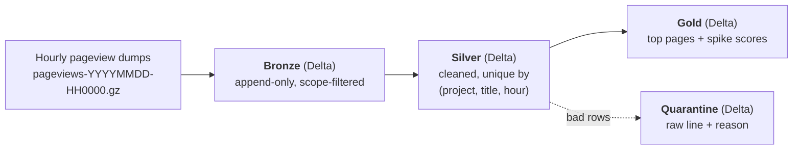

# Vantage

[](https://github.com/kumkumsareen1006/Vantage/actions/workflows/tests.yml)

A Spark + Delta Lake pipeline over English Wikipedia pageviews. Phase 1 answers
which articles suddenly drew unusual attention in a given hour — a spike of views
larger than their own recent history explains — and which of those spikes look
automated rather than driven by real readers. The fuller question this project is
built toward, whether people were editing those same articles at the same time,
needs the live edit stream, which arrives in Phase 2. Phase 1 reads the raw hourly
pageview dumps, cleans and aggregates them through medallion layers, and scores
each (title, hour) against a 24-hour baseline. The automated-traffic flag is a
heuristic: a desktop-only, single-hour burst is a strong signal of scraper or
redirect traffic, not a verified label.

This is Phase 1: a local batch lakehouse. Phase 2 (streaming) and Phase 3
(cloud) are [planned](#roadmap).

## Architecture



- **Bronze** — every in-scope raw line landed exactly as read, one file per hour,
  appended and never rewritten. Re-landing a file is a no-op, so the ingest is
  idempotent. Every in-scope line of every landed file is there; nothing is
  filtered beyond the en/en.m scope.
- **Silver** — parsed, title-normalized, collision-aggregated, and unique by
  `(project, title, hour)`. Written with a MERGE that replaces a key's row
  instead of adding one, so a rerun can't double-count.
- **Quarantine** — any row that fails to parse or validate is kept here with its
  raw text and a reason, never dropped silently and never allowed to crash the
  run. Reprocessing a file clears its old quarantine rows first.
- **Gold** — `top_pages_hourly`, `top_pages_daily`, and `spikes` (the z-score
  table). Each is a pure function of Silver, overwritten every build, so it can't
  accumulate or drift; a build is skipped entirely when Silver hasn't changed.

The full set of filters, drops, and thresholds each layer applies is written up
as an exact spec in [docs/cleaning-rules.md](docs/cleaning-rules.md).

## Scope: `en` and `en.m` only

Vantage keeps only the English desktop (`en`) and English mobile (`en.m`)
projects and drops everything else — at ingest, in Bronze, before anything is
stored. That is a **scoping** decision, not a cleaning one: the full hourly dump
is every project and language and would be far larger than this needs to be to
run on a laptop. Narrowing to two projects keeps the data small enough to
iterate on while staying real, uncontrolled public data. The two are kept
separate through Silver (the desktop/mobile split is what the automated-traffic
flag later depends on) and summed per title in Gold.

## Why Delta

The layers lean on three Delta features that plain Parquet doesn't give you:

- **MERGE** makes Silver idempotent. A key that already exists is updated in
  place rather than appended, so reprocessing a file — or rerunning the whole
  window — converges to the same table instead of piling up duplicates.
- **Schema enforcement** means a stage can't quietly write the wrong shape; a
  column type mismatch fails the write instead of corrupting the table. New
  optional columns are added deliberately with `mergeSchema`.
- **Time travel** keeps each write as a version, so an earlier state of a table
  can be read back by version — exercised in `tests/test_spark_smoke.py`, which
  writes, MERGEs, then reads the pre-MERGE version with `versionAsOf`. VACUUM
  `RETAIN 24 HOURS` then caps how far back time travel reaches at the last 24
  hours of versions.

A separate **quarantine table** exists because the alternative — dropping a bad
line, or letting it throw — either loses data silently or stops a 150M-row run
on one malformed row. Quarantine keeps every rejected line with a reason, so the
reject rate is a number you can watch and the bad rows are there to inspect. A
pageview line that is invalid UTF-8, splits into the wrong number of fields, or
carries a non-integer view count goes to quarantine, not to Silver.

## Idempotency

Silver is written with a MERGE keyed on `(date, project, title, hour)`. A matched
key has its `views`, `bytes`, and `source_file` **replaced**; an unmatched key is
inserted. Nothing is appended to an existing key. So running the pipeline twice,
or rerunning it with `--full`, lands the same table — not a doubled one.

The proof is in both the data and the tests:

- A `--full` rebuild of all 72 files produces exactly `142,728,341` Silver rows,
  and a `GROUP BY (project, title, hour) HAVING count > 1` over that table
  returns **0** duplicate keys.
- `tests/test_silver_merge.py` merges the same batch twice and asserts the row
  count stays `1` with no duplicate key, then merges a changed value and asserts
  the row is replaced (10 → 20, not 30).

## Results

Window: **2026-10-15 00:00 – 2026-10-18 00:00 UTC**, three UTC days, 72 hourly
files. Every number below comes from the `run_metrics` Delta table, a direct
query on the Delta tables, or a test/command run — sources are footnoted; none
are from notes or memory.

| Metric | Value | Source |
|---|---|---|
| Pageview files ingested | 72 | [1] |
| Rows ingested (Bronze) | 152,935,529 | [2] |
| Silver rows | 142,728,341 | [3] |
| Collisions merged (same key, different raw spelling) | 8,678 | [4] |
| Rows quarantined | 0 (0.0000%) | [5] |
| Duplicate Silver keys after a full rerun | 0 | [6] |
| Gold rows | 84,348 = 7,200 hourly + 300 daily + 76,848 spikes | [7] |
| Titles scored for spikes / flagged `is_spike` / `likely_automated` | 1,601 / 2,027 / 7 | [8] |
| Silver files before → after OPTIMIZE | 3 → 3 (already compact) | [9] |
| Silver on-disk before → after VACUUM (RETAIN 24h) | 11,757.0 MB → 2,395.8 MB (reclaimed 9,361.2 MB) | [10] |
| Whole lake on disk before → after VACUUM | ~13 GB → 4.3 GB | [11] |
| Full run: Silver `--full` rebuild (72 files) + Gold | 1,964 s total (Silver MERGE 1,521 s, Gold 434 s) | [12] |
| No-op run (nothing to ingest): Gold rebuilt → Gold skipped | 385 s → 20 s | [13] |
| Tests | 58 passed | [14] |
| CI | green on GitHub Actions (ubuntu-24.04, Temurin 17) | [15] |

<sub>

**Sources.** [1] Bronze `COUNT(DISTINCT source_file)`; also `run_metrics` Silver
`files_processed`. [2] Bronze `count()`. [3] Silver `count()`; also `run_metrics`
Silver `rows_out`. [4] `run_metrics` Silver `rows_in − rows_out`
(142,737,019 − 142,728,341) on the full run of 2026-10-23. [5] `run_metrics`
Silver `rows_quarantined`, over the 152,935,529 Bronze rows. [6] Silver
`GROUP BY (project, title, hour) HAVING count > 1` → 0; `tests/test_silver_merge.py`.
[7] `count()` on each Gold table; also `run_metrics` Gold `rows_out` = 84,348.
[8] Queries on `gold/spikes`: distinct `title`, rows with `is_spike`, rows with
`likely_automated`. [9] `run_metrics` stage `optimize` (`scripts/optimize_silver.py`).
[10] `run_metrics` stage `vacuum:silver` (`scripts/vacuum_tables.py`). [11] `du -sh
data/lake` before and after that VACUUM. [12] `run_metrics`, run 2026-10-23
16:17 UTC (Bronze already landed, so 0 new files that run). [13] `run_metrics`,
runs 2026-10-25 13:36 UTC (Gold rebuilt, 369 s) and 13:42 UTC (Gold skipped,
~1 s). [14] `pytest -q`, 58 passed in 59.4 s locally. [15] GitHub Actions
`tests` workflow, 58 passed in 112.6 s. [16] `scripts/build_silver.py` run output
on Day 7 (4,356.8 s per-file, 1,354.5 s per-day), before `run_metrics` existed.

</sub>

## Findings

**The largest spike in the window was automated traffic, and the flag caught it.**
The single biggest spike was `Ying` — **886,853 views in the one hour
2026-10-17 17:00**, against a baseline near zero. It is 90% desktop
(en 798,356 / en.m 88,497), both neighbouring hours have **0** views, and there
were no edits to the article all window. That shape — one isolated hour, almost
all desktop — is what `likely_automated` is built to catch, and `Ying` is
flagged. Compare `Hôtel_de_Ville,_Limoges`, flagged `is_spike` across 19:00–23:00
the same day: it ramps and decays over several hours and skews mobile
(21:00 was en 2,425 / en.m 4,894), so it is **not** labelled automated — it reads
as real attention. The flag is a label on top of `is_spike`, never a drop, and
the spikes table keeps the view split and both neighbour counts so every label is
auditable.

**Grouping the Silver MERGE by day, not by file, cut the full rebuild ~3×.** The
first version ran one MERGE per pageview file, and each per-file run filtered
Bronze on `source_file` — which isn't the partition column (Bronze is partitioned
by `file_date`). The physical plan showed `PartitionFilters: []`, so nothing was
pruned and the full parse → aggregate → MERGE cycle ran once per file, 72 times
over the window. Switching the batch key to the `file_date` partition prunes the
read to a single day, and because every file covers exactly one hour a day's 24
files aggregate to a byte-identical result, so the window runs in 3 per-day cycles
instead of 72. That dropped the full Silver rebuild from **4,357 s to 1,355 s** [16];
the current `--full` rebuild runs in 1,521 s [12]. The first per-day run then
OOM'd the 4 GB driver — a day's batch is ~24× a single file — until the
aggregation was pinned back to the file-sized task shape (32 MB input partitions,
200 shuffle partitions, AQE coalescing off) so the group-by's hash map stays
inside the heap.

**A parity test caught a UTF-8 quarantine bug.**
`tests/test_parity.py` runs the Phase 0 pandas prototype and the Spark pipeline on
the same fixture — which includes a line with genuinely invalid UTF-8 bytes — and
asserts they produce the identical clean-row set, the same collision count, and
the same quarantine counts *by reason*. The Spark rule flagged `bad_utf8` by
testing whether a line contained the replacement character U+FFFD, assuming
`spark.read.text` substitutes it for invalid bytes. It doesn't: Spark keeps the
raw bytes, so the rule never matched genuinely invalid UTF-8 (the fixture's bad
line slipped past it) and instead wrongly flagged valid lines that happened to
carry a literal U+FFFD. The parity test failed on the per-reason quarantine
counts. The fix flags a line only when it fails a UTF-8 round trip
(`raw_line != decode(encode(raw_line))`). Rebuilding Silver brought the **4** real
`en` article lines whose titles contained a literal U+FFFD back as clean rows, and
the invalid-bytes line now quarantines as `bad_utf8` on both the prototype and
Spark.

## Honest limits

- **It's a 72-hour window.** Three UTC days is enough to prove the pipeline and
  surface real spikes, not enough to characterize weekly or seasonal patterns.
  The spike baseline is 24 hours, so only the last ~48 hours are even scorable.
- **Zero rows were actually quarantined.** The real dump in this window was clean,
  so the 0.0000% reject rate reflects the input, not an untested path. The
  quarantine rules are exercised instead by `tests/test_parity.py` and the unit
  tests against a hand-built fixture with deliberately malformed lines — that is
  where `bad_utf8`, `wrong_field_count`, `bad_url_encoding` and the rest are
  proven, not on production data.
- **`likely_automated` is a heuristic, not ground truth.** "Desktop-dominated and
  isolated" is a strong signal for scraper/redirect bursts, but it is a rule of
  thumb with two tuned thresholds (`DESKTOP_SHARE_MIN = 0.8`,
  `ISOLATION_RATIO = 0.05`), not a verified classification. It's a label to
  filter or inspect by, deliberately kept separate from `is_spike`.

## How to run

Requires **Python 3.11** and **Java 17**. Spark 3.5 supports Java 8, 11 and 17.
On this machine the default JDK 23 crashed Spark with a `getSubject` / security
manager error, so point `JAVA_HOME` at 17:

```bash
export JAVA_HOME=/opt/homebrew/opt/openjdk@17    # macOS/Homebrew; adjust for your box

python -m venv .venv && source .venv/bin/activate
pip install -r requirements.txt

pytest -q                                        # 58 tests

# batch pipeline: bronze -> silver -> gold, one run_id, run_metrics row per stage
python scripts/run_pipeline.py --start 2026-10-15T00 --end 2026-10-18T00
python scripts/run_pipeline.py --full            # reprocess every file through Silver

# maintenance (each in its own Spark session; run on their own, not chained)
python scripts/optimize_silver.py                # compact Silver
python scripts/vacuum_tables.py                  # VACUUM RETAIN 24h, reclaim stale versions
```

A failed stage stops the run, marks the rest skipped, and exits non-zero. Each
run writes one JSON line per stage to `logs/pipeline.jsonl` and one row per stage
to the `run_metrics` Delta table.

## Roadmap

- **Phase 1 — batch lakehouse (this repo).** Pageviews → Bronze → Silver → Gold
  on local Delta, with CI. Done.
- **Phase 2 — streaming (planned).** The live recent-changes edit stream, already
  being captured, fed through Kafka and Spark Structured Streaming into the same
  medallion layers, then joined to pageviews on normalized title + UTC hour to add
  an edit-spike signal.
- **Phase 3 — cloud (planned, optional).** Run the same pipeline on Azure (ADLS
  Gen2 storage, Databricks, Data Factory) and confirm the row counts match the
  local run.

---

A data engineering portfolio project by Kumkum Sareen.
